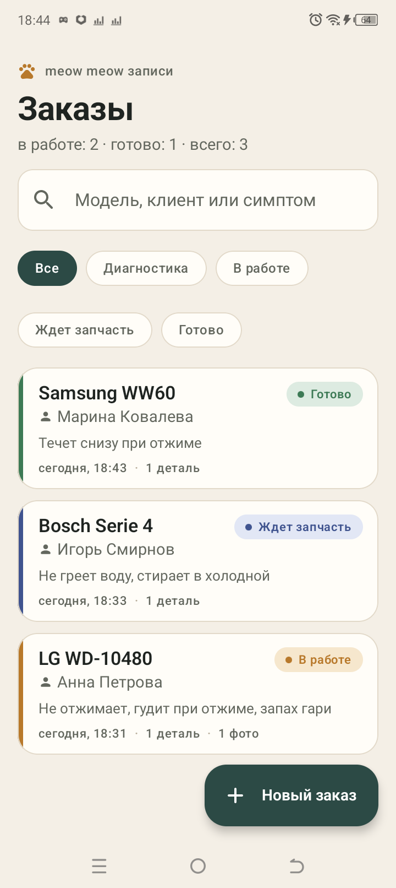
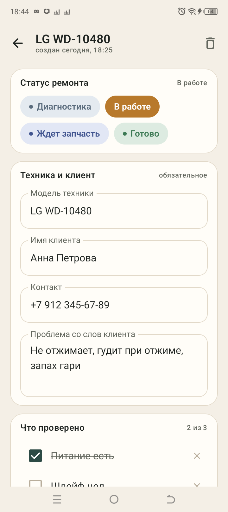
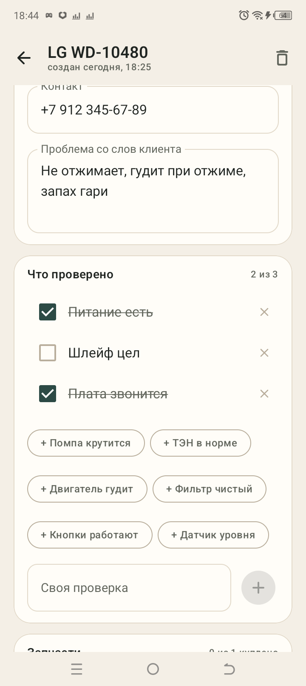
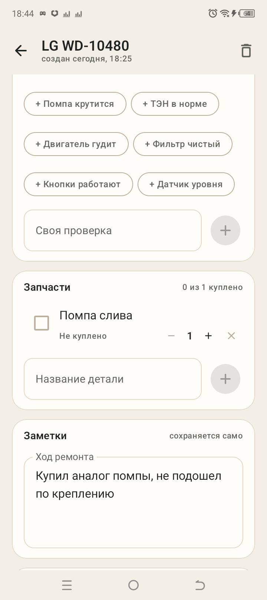
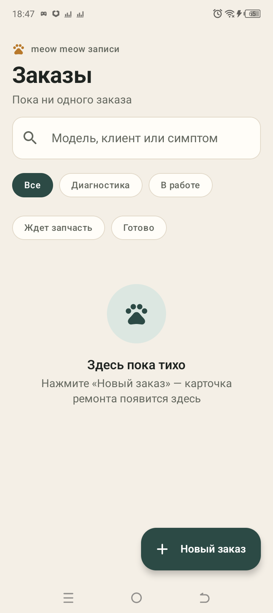
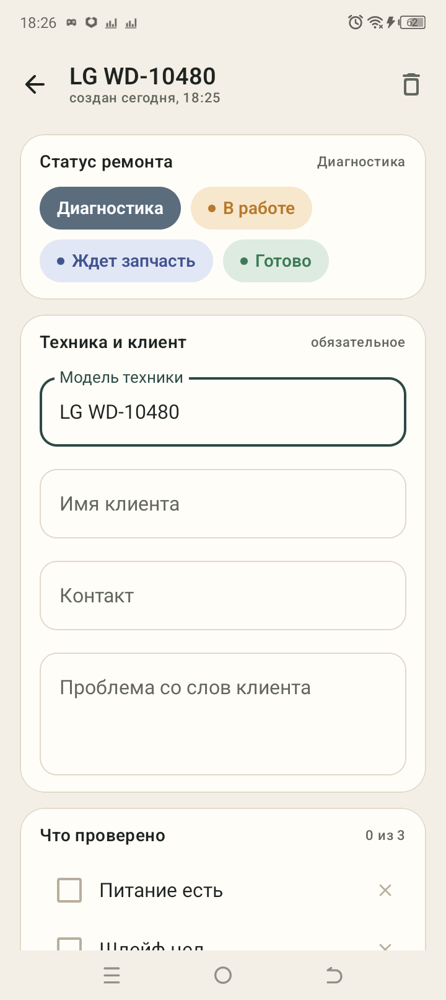
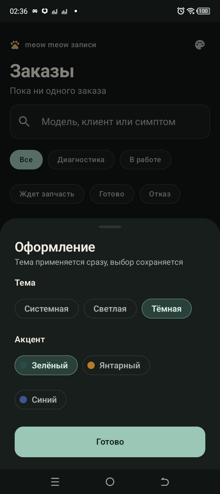
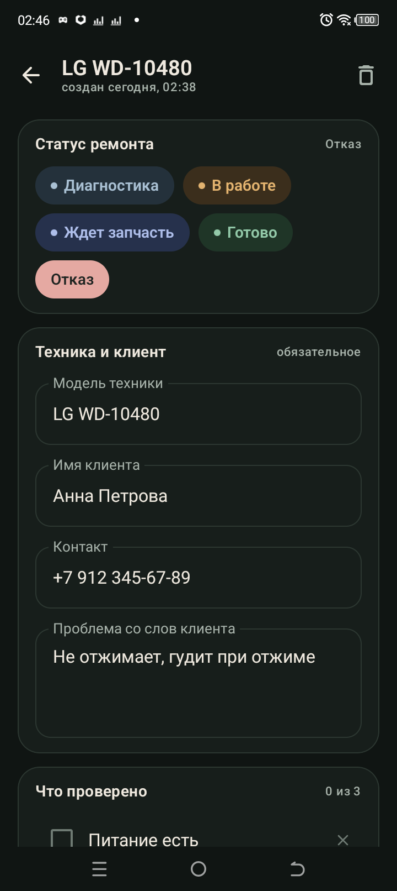
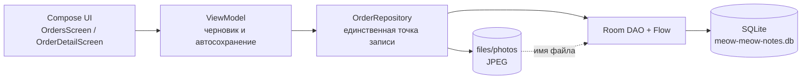

# meow meow записи

**Личный инструмент мастера по ремонту бытовой техники.** Заказы, клиенты, диагностика,
запчасти, заметки и фото — всё в одном приложении, полностью офлайн.

[](https://github.com/kidjinbruh-del/meow-meow-zapisi/actions/workflows/android.yml)
[](https://github.com/kidjinbruh-del/meow-meow-zapisi/releases/latest)
[](LICENSE)
[](app/build.gradle.kts)
[](https://kotlinlang.org)

[**Скачать APK 1.1.0**](https://github.com/kidjinbruh-del/meow-meow-zapisi/releases/latest/download/meow-meow-zapisi-1.1.0.apk) ·
[Скриншоты](#скриншоты) · [Архитектура](docs/ARCHITECTURE.md) · [База данных](docs/DATABASE.md) · [Дизайн](docs/DESIGN.md)

---

## Зачем это

Мастер приезжает к клиенту, разбирает технику и по ходу дела держит в голове десяток
мелочей: какая модель, что сказал хозяин, что уже проверено, какую деталь заказать,
что не подошло. Приложение заменяет блокнот и заметки в телефоне: одна карточка на
ремонт, снимки деталей и маркировки, чек-лист диагностики и список запчастей.

Всё хранится локально — в мастерской, подвале или у клиента за городом интернет не нужен.

> Рабочее название из технического задания — «Мастерская». Приложение называется
> **meow meow записи**.

## Скриншоты

| Список заказов | Карточка заказа |
| --- | --- |
|  |  |

| Что проверено | Запчасти и заметки |
| --- | --- |
|  |  |

| Пустой список | Новая карточка |
| --- | --- |
|  |  |

| Тёмная тема | Статус «Отказ» |
| --- | --- |
|  |  |

Скриншоты сняты на реальном устройстве (TECNO BF7, Android 12): интерфейс в debug и
release одинаковый; тёмная тема и «Отказ» — из версии 1.1.

## Возможности

### Список заказов
- Карточки: модель, клиент, превью проблемы, статус цветной полосой и пилюлей,
  дата последней активности, число деталей и фото.
- Поиск по модели, имени клиента и тексту проблемы.
- Фильтр по статусу: Все / Диагностика / В работе / Ждет запчасть / Готово / Отказ.
- Кнопка «Новый заказ»: запись создаётся сразу и открывается карточкой.

### Карточка заказа
- Поля: модель техники, имя клиента, контакт, проблема со слов клиента.
- Статус: Диагностика → В работе → Заказана запчасть → Готово → Отказ
  (в интерфейсе — короткие формы «Ждет запчасть», «Готово», «Отказ»).
- «Что проверено»: чек-лист с тремя типовыми проверками, подсказками и своими пунктами.
- «Запчасти»: название, количество 1–99, «Куплено / Не куплено», переименование, удаление.
- «Заметки»: свободный многострочный текст, сохраняется сам.
- «Фото»: съёмка через системную камеру, импорт из галереи, миниатюры, полноэкранный
  просмотр, удаление вместе с файлом. Долгое нажатие включает мультивыбор —
  можно закрепить сразу несколько снимков (они поднимаются в начало сетки).
- Удаление заказа с подтверждением: каскадно уходят чек-лист, запчасти, фото и файлы.

### Оформление
- Тема: системная, светлая или тёмная.
- Акцент: зелёный, янтарный или синий; применяется сразу и сохраняется.
- Настройка — иконка палитры на главном экране, отдельного экрана настроек нет.

### Данные
- SQLite (Room) в приватном каталоге приложения, режим WAL.
- Фото — файлы в `files/photos`, в базе только имя файла.
- Никаких разрешений на камеру и хранилище: съёмка через `ACTION_IMAGE_CAPTURE` +
  `FileProvider`, галерея — через системный Photo Picker.
- Интернет не используется вовсе (в манифесте нет разрешения `INTERNET`).

### Архив и перенос
- Меню «⋮» в шапке: «Экспорт в файл» / «Импорт из файла», файл выбирается
  системным диалогом — разрешений на хранилище не нужно.
- Архив — читаемый JSON: четыре таблицы, версия формата, дата выгрузки.
- Импорт обновляет записи по `id`, добавляет новые и не удаляет локальные:
  один и тот же файл можно вливать повторно, ничего не потеряется.
- Снимки в файл не попадают — это мегабайты. При импорте подхватываются фото,
  чьи файлы уже лежат в `files/photos`; остальные пропускаются, и в тосте видно,
  сколько осталось без файлов.

## Технологии

| Слой | Решение |
| --- | --- |
| Язык и UI | Kotlin 2.0.21, Jetpack Compose (BOM 2024.10.01), Material 3 |
| Хранение | Room 2.6.1 поверх SQLite, KSP |
| Архив | kotlinx.serialization 1.7.3, читаемый JSON, версия формата в файле |
| Асинхронность | Kotlin Coroutines, Flow, `stateIn` |
| Сборка | AGP 8.5.2, JDK 17, compileSdk 35, minSdk 24, targetSdk 35 |
| Навигация | Одно Activity + состояние `openOrderId`, системный back |
| Тесты | JUnit 4 (JVM) + AndroidX Test / Room in-memory (instrumented) |
| CI | GitHub Actions: сборка debug APK и JVM-тесты |

### Почему нативный Kotlin, а не Flutter / React Native / Kivy

| Критерий | Kotlin + Compose | Flutter | React Native | Kivy |
| --- | --- | --- | --- | --- |
| Старт под Android | Только Android SDK | Flutter SDK + Android SDK | Node + Android SDK | Python + buildozer |
| Камера и файлы | Штатные API | Плагины | Плагины и нативные модули | Ручная работа с Android API |
| SQLite | Room: схема, миграции, Flow | `sqflite` | `react-native-sqlite-storage` | `sqlite3` без ORM |
| Сборка APK | `gradlew assembleRelease` на любой ОС | `flutter build apk` | Gradle + Metro | buildozer только на Linux/macOS |
| Внешний вид | Нативный Material 3 | Собственный рендер | Нативные компоненты через мост | Ненативные виджеты |
| iOS | Нет | Да | Да | Нет |

Для Android-only инструмента нативный стек — самый короткий путь к рабочему APK:
нет прослойки плагинов, камера и файлы штатные, Room закрывает схему и реактивность.
Если понадобится iOS, разумный шаг — Flutter: сущности и правила переносятся почти
один в один.

## Архитектура



- **UI** не знает про SQL: только состояние и события.
- **ViewModel** держит черновик текстовых полей и сохраняет его с задержкой 250 мс,
  а также при уходе с экрана и сворачивании приложения.
- **Repository** — единственное место, где меняются данные; здесь же каскадное
  удаление файлов фото.
- **Room** отдаёт `Flow`, поэтому список и секции обновляются сами.

Подробнее: [docs/ARCHITECTURE.md](docs/ARCHITECTURE.md).

## Схема данных

Четыре таблицы, связи 1 → N с каскадным удалением:

```sql
orders (id, model, clientName, clientContact, problem, status, notes, createdAt, updatedAt)
checklist_items (id, orderId → orders.id, label, isChecked, position)
parts (id, orderId → orders.id, name, quantity, isBought, position)
photos (id, orderId → orders.id, fileName, caption, createdAt, isPinned)
```

Полный DDL, инварианты и правила миграций: [docs/DATABASE.md](docs/DATABASE.md).
Машинная схема Room: [`app/schemas/.../2.json`](app/schemas/ru.meowmeow.notes.data.AppDatabase/2.json).

## Сборка и запуск

Нужны **JDK 17** и **Android SDK** с `platforms;android-35` и `build-tools;35.0.0`.
Путь к SDK укажите в `local.properties`:

```properties
sdk.dir=/path/to/Android/Sdk
```

```bash
# debug
./gradlew :app:assembleDebug          # Windows: gradlew.bat :app:assembleDebug

# release (без ключа соберётся unsigned)
./gradlew :app:assembleRelease
```

Установка на телефон:

```bash
adb install -r app/build/outputs/apk/release/app-release.apk
```

### Подпись

Ключ подписи **не входит в репозиторий**. Для собственного release создайте
`keystore.properties` по образцу [`keystore.properties.example`](keystore.properties.example):

```bash
keytool -genkeypair -v -keystore release.jks -alias meow \
  -keyalg RSA -keysize 2048 -validity 10000
```

APK из раздела [Releases](https://github.com/kidjinbruh-del/meow-meow-zapisi/releases/latest)
подписан отдельным ключом автора сборки.

## Тесты

```bash
./gradlew :app:testDebugUnitTest          # 12 JVM-тестов
./gradlew :app:connectedDebugAndroidTest  # 13 тестов на устройстве/эмуляторе
```

| Что покрыто | Где |
| --- | --- |
| Склонения, даты, превью текста, статусы (включая «Отказ») и fallback ключа | `app/src/test/.../TextTest.kt` |
| Формат архива: полный круг, чужие и битые файлы, незнакомый статус, имена фото | `app/src/test/.../BackupJsonTest.kt` |
| Схема SQLite, каскады, чек-лист, запчасти, сохранение текста, фото и миниатюры, закрепление пачкой, экспорт и импорт | `app/src/androidTest/.../RepositoryTest.kt` |
| Миграция 1 → 2: колонка `isPinned` и сохранность заказов/фото | `app/src/androidTest/.../MigrationTest.kt` |

Результат на 27.10.2026: **12/12** JVM- и **13/13** инструментальных тестов на TECNO BF7
(Android 12), плюс ручная проверка экспорта и импорта на релизной сборке. CI собирает
debug APK и гоняет JVM-тесты на каждый push.

## Структура проекта

```
app/src/main/java/ru/meowmeow/notes/
├─ MeowApp.kt              Application: база, репозиторий, app-scope
├─ MainActivity.kt          Activity и навигация список ↔ карточка
├─ data/                    Room-сущности, DAO, база, репозиторий, фото, JSON-архив
├─ domain/                  статусы, заготовки проверок, форматирование
└─ ui/                      Compose-экраны, ViewModel, компоненты, тема
```

## Ограничения

- Только Android; iOS-кода нет.
- Нет синхронизации между устройствами: архив переносит базу, но не снимки —
  на новом телефоне фото придётся добавить заново.
- Удаление приложения уносит базу и фото, если заранее не сделан экспорт.
- Нет напоминаний и архива готовых заказов.
- Подписи к фото есть в схеме, но пока не редактируются в интерфейсе.
- Фото не попадают в системную галерею — только внутрь приложения.
- Камера проверялась на устройстве без рабочего превью: запуск камеры и `FileProvider`
  работают, запись снимка покрыта инструментальным тестом на сгенерированном JPEG.

## Планы

1. Группировка готовых заказов «Сегодня / На этой неделе / Раньше».
2. Напоминание о заказе запчасти (WorkManager + уведомление).
3. Экспорт карточки в PDF и «Поделиться» списком деталей.
4. ZIP-архив вместе с фото: сейчас JSON переносит только базу.
5. Подписи к фото и серия снимков подряд.
6. Крупный шрифт и масштаб интерфейса.

## Лицензия

[MIT](LICENSE) © 2026 kidjinbruh-del

Название, иконка и тексты интерфейса — часть проекта. Сторонние библиотеки
распространяются по своим лицензиям (AndroidX, Kotlin, Compose, Room).
