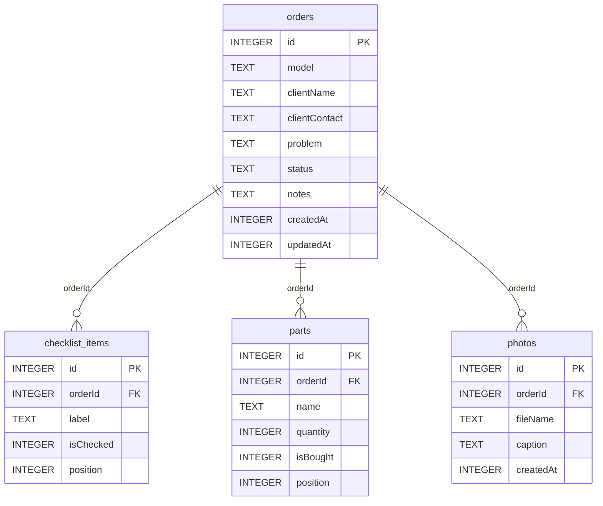

# База данных

СУБД — SQLite, доступ через Room 2.6.1. Файл базы: `meow-meow-notes.db` в приватном
каталоге приложения (`/data/data/ru.meowmeow.notes/databases/`). Режим WAL включён
по умолчанию.

Источник истины — [`Entities.kt`](../app/src/main/java/ru/meowmeow/notes/data/Entities.kt),
машинная схема — [`app/schemas/.../1.json`](../app/schemas/ru.meowmeow.notes.data.AppDatabase/1.json).

## ER-диаграмма



## DDL

```sql
CREATE TABLE orders (
    id INTEGER PRIMARY KEY AUTOINCREMENT NOT NULL,
    model TEXT NOT NULL,
    clientName TEXT NOT NULL,
    clientContact TEXT NOT NULL,
    problem TEXT NOT NULL,
    status TEXT NOT NULL,
    notes TEXT NOT NULL,
    createdAt INTEGER NOT NULL,
    updatedAt INTEGER NOT NULL
);

CREATE TABLE checklist_items (
    id INTEGER PRIMARY KEY AUTOINCREMENT NOT NULL,
    orderId INTEGER NOT NULL,
    label TEXT NOT NULL,
    isChecked INTEGER NOT NULL,
    position INTEGER NOT NULL,
    FOREIGN KEY (orderId) REFERENCES orders(id) ON UPDATE NO ACTION ON DELETE CASCADE
);
CREATE INDEX index_checklist_items_orderId ON checklist_items(orderId);

CREATE TABLE parts (
    id INTEGER PRIMARY KEY AUTOINCREMENT NOT NULL,
    orderId INTEGER NOT NULL,
    name TEXT NOT NULL,
    quantity INTEGER NOT NULL,
    isBought INTEGER NOT NULL,
    position INTEGER NOT NULL,
    FOREIGN KEY (orderId) REFERENCES orders(id) ON UPDATE NO ACTION ON DELETE CASCADE
);
CREATE INDEX index_parts_orderId ON parts(orderId);

CREATE TABLE photos (
    id INTEGER PRIMARY KEY AUTOINCREMENT NOT NULL,
    orderId INTEGER NOT NULL,
    fileName TEXT NOT NULL,
    caption TEXT NOT NULL,
    createdAt INTEGER NOT NULL,
    FOREIGN KEY (orderId) REFERENCES orders(id) ON UPDATE NO ACTION ON DELETE CASCADE
);
CREATE INDEX index_photos_orderId ON photos(orderId);
```

## Поля

### orders

| Поле | Тип | Смысл |
| --- | --- | --- |
| `id` | INTEGER PK | Номер заказа, показывается в подвале карточки |
| `model` | TEXT | Модель техники; пустая строка — «Новый заказ» |
| `clientName` | TEXT | Имя клиента |
| `clientContact` | TEXT | Телефон или другой контакт, свободный текст |
| `problem` | TEXT | Изначальная проблема со слов клиента, многострочно |
| `status` | TEXT | `diagnosis` \| `in_progress` \| `part_ordered` \| `done` |
| `notes` | TEXT | Заметки по ходу ремонта |
| `createdAt` | INTEGER | Создан, epoch millis |
| `updatedAt` | INTEGER | Последняя активность; сортировка списка |

### checklist_items

| Поле | Тип | Смысл |
| --- | --- | --- |
| `id` | INTEGER PK | |
| `orderId` | INTEGER FK | Заказ, каскадное удаление |
| `label` | TEXT | Формулировка проверки |
| `isChecked` | INTEGER | 0 — не проверено, 1 — проверено |
| `position` | INTEGER | Порядок в секции |

### parts

| Поле | Тип | Смысл |
| --- | --- | --- |
| `id` | INTEGER PK | |
| `orderId` | INTEGER FK | Заказ, каскадное удаление |
| `name` | TEXT | Название детали |
| `quantity` | INTEGER | 1–99, ограничение в репозитории |
| `isBought` | INTEGER | 0 — не куплено, 1 — куплено |
| `position` | INTEGER | Порядок в секции |

### photos

| Поле | Тип | Смысл |
| --- | --- | --- |
| `id` | INTEGER PK | |
| `orderId` | INTEGER FK | Заказ, каскадное удаление |
| `fileName` | TEXT | Имя файла в `files/photos`, например `order_3_be6f34c3.jpg` |
| `caption` | TEXT | Задел под подписи, интерфейс пока не редактирует |
| `createdAt` | INTEGER | Время снимка/импорта |

## Инварианты

1. У заказа всегда есть `status` из четырёх ключей; неизвестное значение читается
   как `diagnosis` (`OrderStatus.fromKey`).
2. `quantity` всегда ≥ 1; UI не даёт уйти ниже 1, репозиторий дополнительно
   ограничивает диапазоном 1–99.
3. `position` уникален только по смыслу; при добавлении берётся `MAX(position) + 1`.
4. Удаление заказа удаляет все дочерние строки (FK `ON DELETE CASCADE`).
5. Строка `photos` существует только если файл существует и не пуст: проверка в
   `OrderRepository.attachPhoto`.
6. `updatedAt` обновляется при любом изменении заказа, включая правки чек-листа,
   запчастей и фото (`touch`).

## Запросы

**Карточки списка** — один запрос с тремя подзапросами:

```sql
SELECT o.*,
       (SELECT COUNT(*) FROM parts p WHERE p.orderId = o.id) AS partsCount,
       (SELECT COUNT(*) FROM parts p WHERE p.orderId = o.id AND p.isBought = 1) AS partsBought,
       (SELECT COUNT(*) FROM photos ph WHERE ph.orderId = o.id) AS photosCount
FROM orders o
ORDER BY o.updatedAt DESC;
```

**Секции карточки** — отдельные `Flow` по `orderId`, сортировка `position, id`
(для фото — `createdAt, id`).

**Обновление времени активности:**

```sql
UPDATE orders SET updatedAt = :timestamp WHERE id = :id;
```

## Миграции

- Версия схемы: `1`.
- `exportSchema = true`, JSON лежит в `app/schemas` и коммитится.
- Политика: при изменении схемы — новая версия, `Migration` с явным SQL и тест
  миграции. `fallbackToDestructiveMigration()` **не используется**: данные мастера
  не должны теряться при обновлении.
- Новый статус добавляется значением enum без изменения схемы.

## Файлы фото

- Каталог: `files/photos`, имя `order_<orderId>_<8 hex>.jpg`.
- В базе — только имя, не абсолютный путь: приложение можно перенести, путь
  вычисляется от `filesDir`.
- Удаление фото: файл → строка.
- Удаление заказа: все файлы заказа → строка заказа.
- Осиротевшие файлы возможны только при сбое посреди удаления; лечатся ручной
  очисткой каталога (в планах — проверка при старте).

## Резервное копирование

`android:allowBackup="true"` — база и фото попадают в системный бэкап Android.
Собственного экспорта пока нет; в планах ZIP с базой и каталогом фото.
